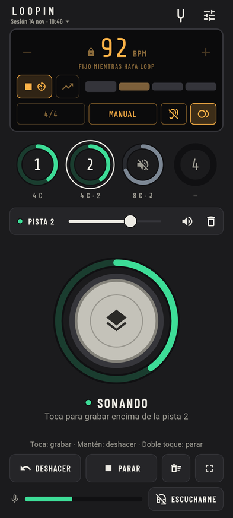
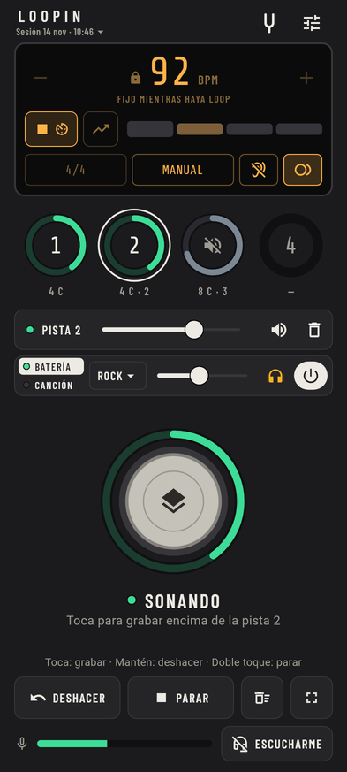
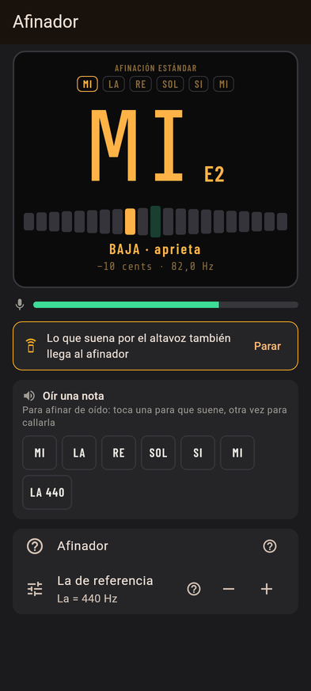
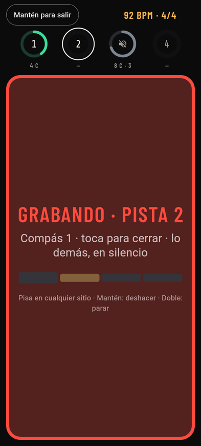

# Loopin

**Looper de guitarra libre para Android.** Grabas una base, tocas encima y vas sumando pistas que siempre cuadran al compás. Para practicar y tocar en cualquier sitio, con el micrófono del móvil o con una interfaz USB.

[Read in English](README.md)

  
  
  
  

## Qué hace

- **Looper de 4 pistas con un pulsador grande que hace de pedal:** tocar graba o graba encima, mantener deshace y el doble toque para y arranca. Actúa al pulsar, no al soltar. Las pistas duran 1, 2 o 4 veces la primera y siempre cuadran.
- **Metrónomo** de 40 a 240 BPM con tap tempo, 10 compases y una luz en cada tiempo. El clic puede callarse al empezar a grabar.
- **Grabación sincronizada, manual o libre** (en libre, el tempo sale de lo que tocas) y **empezar al tocar**: la grabación arranca con tu primera nota.
- **Latencia compensada:** se mide sola con el altavoz, o tocando al clic con cascos. Lo que grabas cae en el tiempo.
- **Batería** con 10 estilos y **tus canciones** (WAV, MP3, FLAC) al tempo que quieras, sin cambiar el tono.
- **Afinador** cromático con notas de referencia y **entrenador de tempo**, que sube los BPM poco a poco.
- **Sesiones que se guardan solas**, **exportar a WAV** (la mezcla o cada pista para tu programa de grabación) y **modo escenario**.
- **Modo simple** (lo justo, con el pulsador más grande) y **avanzado**. Tema claro y oscuro, 4 colores, vertical, apaisado y tablet.
- **Manos libres:** botones de volumen, botón de los cascos o un pedal Bluetooth.

## Instalar

Loopin necesita **Android 8.0 o superior**.

- **GitHub:** descarga el APK de [Releases](https://github.com/alexoseayo40-cyber/loopin/releases). `arm64-v8a` vale para casi todos los móviles de los últimos años; `armeabi-v7a`, para los antiguos de 32 bits; el universal vale para los dos, pero pesa más. Para enterarte de las versiones nuevas, sigue el repositorio con [Obtainium](https://github.com/ImranR98/Obtainium).
- **IzzyOnDroid y F-Droid:** después de la 1.0.

**Elige una fuente y quédate en ella.** Lo que se instala desde fuentes distintas puede ir firmado con claves distintas, y cambiar obliga a desinstalar, lo que borra las sesiones. Expórtalas antes (Sesiones › Exportar).

## Conviene saber

- Con el altavoz del móvil, el clic, la batería y la canción se cuelan en lo que grabas (las otras pistas se callan mientras grabas). Con **cascos de cable** suena mejor. Los auriculares Bluetooth tienen demasiado retardo para escucharte en directo.
- Mide la latencia una vez por cada entrada y salida (Ajustes › Audio y latencia): se guarda y se aplica sola.
- Funciona con la app abierta y la pantalla encendida.
- Pistas de hasta 60 s. Canciones de hasta 10 min, en mono.

## Privacidad

Sin anuncios, sin cuentas, sin rastreo y **sin internet**: la app ni siquiera tiene permiso para usarlo. Solo pide el micrófono, para grabarte. Todo se queda en el móvil. Ver [PRIVACY.md](PRIVACY.md).

## ¿Algo falla?

En la app, ve a **Ajustes › Audio y latencia** y toca **Copiar resultados** (o Ajustes › Acerca de › Informar de un problema, que los copia por ti). Luego [abre una incidencia](https://github.com/alexoseayo40-cyber/loopin/issues/new/choose) y pégalos: dicen qué móvil tienes, su audio, la latencia y los cortes, que es lo que hace falta para arreglar problemas en móviles que no tenemos.

## Compilar y colaborar

Cómo compilar la app y pasar los tests: [docs/BUILDING.md](docs/BUILDING.md). Cómo funciona el motor de audio: [docs/MOTOR.md](docs/MOTOR.md).

## Licencia

Loopin es software libre con la **GNU General Public License v3.0 o posterior** ([LICENSE](LICENSE)).

Incluye [Oboe](https://github.com/google/oboe) (Apache 2.0), [SoundTouch](https://codeberg.org/soundtouch/soundtouch) (LGPL 2.1), [dr_libs](https://github.com/mackron/dr_libs) (dominio público / MIT-0), las tipografías Barlow Condensed y Share Tech Mono (SIL Open Font License) y sonidos de [Virtuosity Drums](https://github.com/sfzinstruments/virtuosity_drums) (CC0). Sus licencias están en la app (Ajustes › Acerca de › Licencias de terceros).
