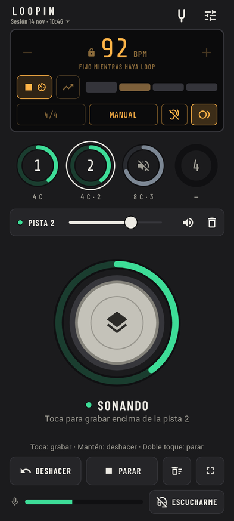
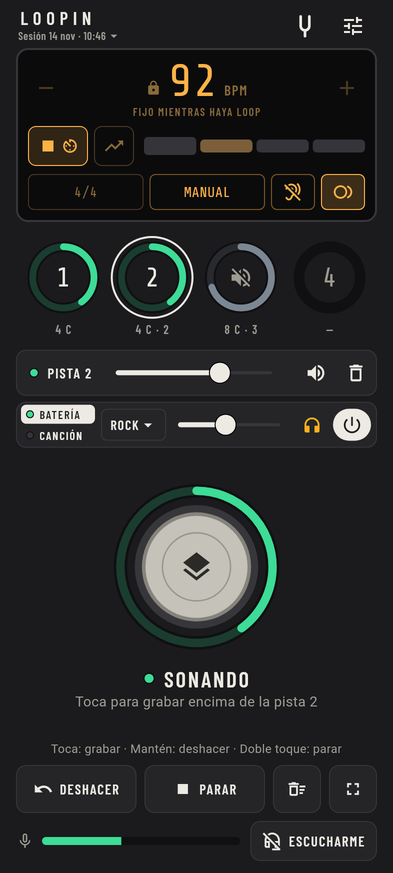
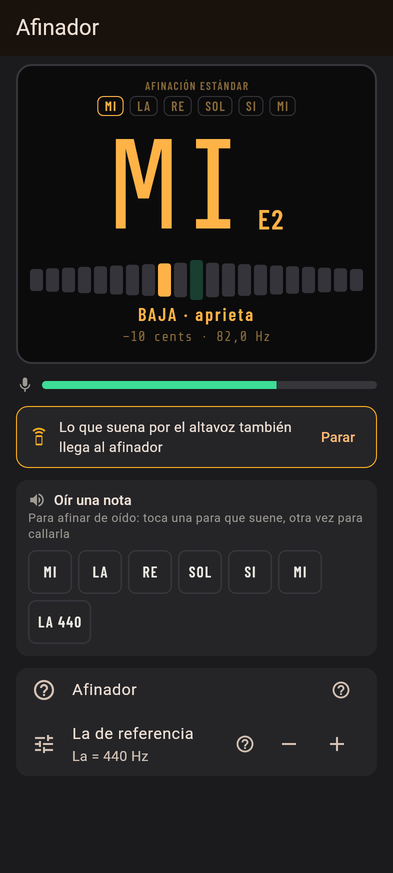
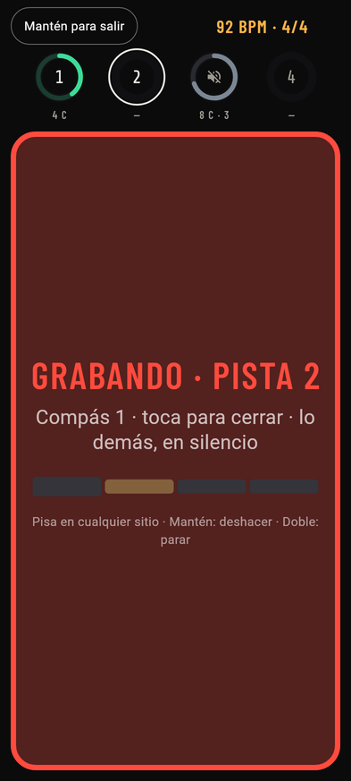

# Loopin

**A free and open source guitar looper for Android.** Record a base, play over it and keep adding tracks that always stay in time. Practise and play anywhere, with the phone's microphone or a USB audio interface.

[Leer en español](README.es.md)

  
  
  
  

> The app is in Spanish for now. English, French, German, Italian and Portuguese are coming in 1.0.

## What it does

- **4-track looper with one big pedal-style button:** tap to record or overdub, hold to undo, double tap to stop and start. It acts when you press, not when you let go. Tracks are 1, 2 or 4 times the length of the first and always stay in time.
- **Metronome** from 40 to 240 BPM with tap tempo, 10 time signatures and a light on every beat. The click can go quiet once you start recording.
- **Synced, manual or free recording** (in free mode the tempo comes from what you play), plus **start on play**: recording begins with your first note.
- **Latency compensation:** measured on its own through the speaker, or by playing along to a click with headphones. What you record lands on the beat.
- **Drums** with 10 styles, and **your own songs** (WAV, MP3, FLAC) at any tempo without changing the pitch.
- Chromatic **tuner** with reference notes, and a **tempo trainer** that raises the BPM step by step.
- **Sessions that save themselves**, **WAV export** (the mix, or every track for your DAW) and **stage mode**.
- **Simple mode** (just the essentials, bigger button) and **advanced mode**. Light and dark themes, 4 colours, portrait, landscape and tablets.
- **Hands-free:** volume buttons, the headset button or a Bluetooth pedal.

## Install

Loopin needs **Android 8.0 or later**.

- **GitHub:** download the APK from [Releases](https://github.com/alexoseayo40-cyber/loopin/releases). `arm64-v8a` fits almost every phone from the last few years; `armeabi-v7a` is for older 32-bit phones; the universal APK works on both but is bigger. To get updates, follow the repository with [Obtainium](https://github.com/ImranR98/Obtainium).
- **IzzyOnDroid and F-Droid:** coming after 1.0.

**Pick one source and stay with it.** Builds from different sources may be signed with different keys, and switching means uninstalling, which deletes your sessions. Export them first (Sessions › Export).

## Good to know

- Through the phone speaker, the click, drums and song bleed into your recording (the other tracks go quiet while you record). **Wired headphones** work best. Bluetooth headphones have too much delay to monitor yourself live.
- Measure the latency once for each input and output (Settings › Audio & latency). It is saved and applied on its own.
- It works while the app is open and the screen is on.
- Tracks up to 60 s. Songs up to 10 min, in mono.

## Privacy

No ads, no accounts, no tracking and **no internet**: the app doesn't even have permission to use it. It only asks for the microphone, to record you. Everything stays on your phone. See [PRIVACY.md](PRIVACY.md).

## Found a problem?

In the app, go to **Settings › Audio & latency** and tap **Copy results** (or Settings › About › Report a problem, which copies them for you). Then [open an issue](https://github.com/alexoseayo40-cyber/loopin/issues/new/choose) and paste them: they tell us your phone, its audio setup, the latency and any dropouts, which is what we need to fix problems on phones we don't have.

## Building and contributing

See [docs/BUILDING.md](docs/BUILDING.md) for how to build the app and run the tests. Notes on how the audio engine works (in Spanish): [docs/MOTOR.md](docs/MOTOR.md).

## Licence

Loopin is free software under the **GNU General Public License v3.0 or later** ([LICENSE](LICENSE)).

It includes [Oboe](https://github.com/google/oboe) (Apache 2.0), [SoundTouch](https://codeberg.org/soundtouch/soundtouch) (LGPL 2.1), [dr_libs](https://github.com/mackron/dr_libs) (public domain / MIT-0), the Barlow Condensed and Share Tech Mono fonts (SIL Open Font License) and drum sounds from [Virtuosity Drums](https://github.com/sfzinstruments/virtuosity_drums) (CC0). Their licences are in the app (Settings › About › Third-party licences).
